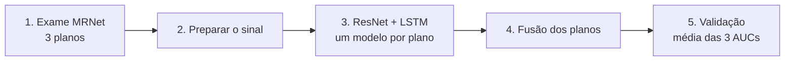

# INF0413 - Seminário

## Título do Seminário
Classificação automática de ressonância do joelho com o MRNet

## Equipe:
202400492 - Rayane Araújo Cunha  
202504007 - Igor Nucada Felix de Souza  
202504022 - Nayane Januario Santos  
202504025 - Thwaverton Oliveira Martins

## Apresentações
1. https://canva.link/2qlupad4rcfk3ej  
2. https://canva.link/qpgufn3wcm55w9u  
3. Link para a apresentação  

## Resumo
A ressonância magnética (RM) é o exame de referência para lesões de joelho, mas cada exame tem dezenas de imagens em três planos, e a leitura manual é demorada e depende da experiência do radiologista. Redes neurais vêm mostrando bom desempenho como apoio a esse diagnóstico, e o dataset público MRNet, da Universidade de Stanford, tornou-se uma referência para comparar métodos. Este projeto segue a proposta da competição MRNet: indicar, para cada exame, se ele é anormal e se há ruptura do ligamento cruzado anterior (LCA) ou do menisco. Cada corte da RM é preparado como um sinal (normalização, filtragem e realce de contraste) e passa por uma ResNet pré-treinada no ImageNet, que extrai as características de cada fatia. Uma LSTM bidirecional relaciona as fatias de cada plano, e uma regressão logística combina os planos axial, coronal e sagital. O modelo é avaliado nos 120 exames da validação oficial pela métrica da competição, a média das AUCs das três tarefas. Espera-se um desempenho próximo ao do MRNet original (AUC média de 0,916), com melhor resultado para anormalidade e LCA do que para menisco. Também se espera identificar qual plano contribui mais para cada tarefa. O projeto deve mostrar que um modelo moderno, treinado em hardware acessível, pode servir de apoio à triagem de exames de joelho.

## Introdução
- **Motivação:** O diagnóstico por imagem é uma das principais ferramentas da medicina moderna, e o volume e a complexidade dos exames crescem a cada ano, aumentando a carga sobre os radiologistas. A RM de joelho é um bom exemplo: é o exame de referência para lesões de ligamento e de menisco, mas cada exame reúne três séries de imagens (sagital, coronal e axial) com 17 a 61 cortes cada, que o radiologista precisa analisar uma a uma. Lesões do LCA e do menisco estão entre as mais comuns do joelho, sobretudo em pessoas jovens e ativas. Um modelo capaz de indicar exames com sinais de anormalidade ou ruptura poderia ajudar a priorizar atendimentos e agilizar a conferência dos exames normais, sempre como apoio, e não como substituto, à decisão médica. Do ponto de vista da disciplina, o problema permite aplicar técnicas de processamento de sinais e imagens a dados reais, multidimensionais e com classes desbalanceadas.
- **Revisão bibliográfica:** Galeno et al. (2020) revisam o uso de redes neurais artificiais no apoio ao diagnóstico radiológico e concluem que elas são eficazes para detectar e classificar lesões em exames de imagem, desde que usadas como apoio ao médico. Antes do deep learning, abordagens com características extraídas manualmente já eram aplicadas à RM de joelho: Štajduhar et al. (2017) usaram descritores HOG e *gist* com SVM e Random Forest para detectar lesões do LCA, alcançando AUC de 0,894. Bien et al. (2018) publicaram o dataset MRNet, com 1.370 exames, e propuseram uma CNN (AlexNet) aplicada a cada corte, com as fatias agregadas por *max pooling* e os planos combinados por regressão logística; o modelo obteve AUC de 0,937 para anormalidade, 0,965 para LCA e 0,847 para menisco, com desempenho próximo ao de radiologistas. Na mesma base de Štajduhar et al., o MRNet chegou a AUC de 0,911 para o LCA. Pereira (2020) substituiu a agregação por uma ResNet50 seguida de uma LSTM bidirecional entre as fatias, chegando a 90,8% de acurácia para anormalidade. Azcona, McGuinness e Smeaton (2020) compararam arquiteturas no MRNet e mostraram que o *transfer learning* e uma estratégia de *data augmentation* bem ajustada são os fatores mais decisivos para o desempenho.
- **Objetivos:** O objetivo geral é desenvolver e avaliar, ao longo de quatro semanas, um classificador de RM de joelho que siga a proposta da competição MRNet. Os objetivos específicos são: (1) estudar o dataset MRNet e preparar os cortes como sinais (normalização, filtragem e realce de contraste); (2) implementar e treinar um modelo ResNet + LSTM bidirecional para as três tarefas (anormalidade, ruptura de LCA e ruptura de menisco); (3) combinar os três planos por regressão logística; e (4) avaliar o modelo pela métrica oficial da competição e comparar o resultado com o MRNet original.

## Metodologia
- **Conjunto de dados (*Dataset*):** Usaremos o dataset público MRNet, da Universidade de Stanford (BIEN et al., 2018), extraído da literatura e não coletado pela equipe. São 1.370 exames de RM de joelho, cada um com três planos (sagital, coronal e axial) e três rótulos: anormal, ruptura de LCA e ruptura de menisco. Os exames vêm divididos em 1.130 de treino e 120 de validação. A primeira análise exploratória mostra classes desbalanceadas: 80,6% dos exames são anormais, 23,3% têm ruptura de LCA e 37,1% ruptura de menisco.
- **Modelos:** Seguiremos a proposta da competição MRNet com um único modelo moderno. Os cortes de cada exame serão preparados como sinais (normalização, filtragem e realce de contraste). Em seguida, uma ResNet pré-treinada no ImageNet extrairá as características de cada fatia, e uma LSTM relacionará as fatias de cada plano. Os três planos serão combinados por regressão logística. Os detalhes de cada etapa serão definidos e apresentados nos checkpoints semanais.
- **Métricas:** Usaremos a métrica da competição, a média das AUCs das três tarefas, calculada nos 120 exames de validação. O resultado será comparado com o do MRNet original (AUC média de 0,916).
- **Fluxograma:**

## Resultados
- Gráficos
- Tabelas
- Multimídia (vídeos, imagens, áudio)

## Discussão
Análise com base na literatura utilizada na Introdução.

## Conclusão
Em que medida os objetivos foram alcançados?

## Referências
AZCONA, D.; MCGUINNESS, K.; SMEATON, A. F. A comparative study of existing and new deep learning methods for detecting knee injuries using the MRNet dataset. In: INTERNATIONAL CONFERENCE ON INTELLIGENT DATA SCIENCE TECHNOLOGIES AND APPLICATIONS (IDSTA), 2020, Valencia. **Proceedings** [...]. IEEE, 2020. p. 149-155. DOI: 10.1109/IDSTA50958.2020.9264030.

BIEN, N. et al. Deep-learning-assisted diagnosis for knee magnetic resonance imaging: development and retrospective validation of MRNet. **PLOS Medicine**, v. 15, n. 11, e1002699, 2018. DOI: 10.1371/journal.pmed.1002699.

GALENO, R. S. et al. Redes neurais artificiais aplicadas no apoio ao diagnóstico radiológico: avanços tecnológicos na prática médica. In: CONGRESSO INTERNACIONAL TRANSDISCIPLINAR (CONITRA), 1., 2020. **Anais** [...]. Doity, 2020. Disponível em: https://doity.com.br/anais/congresso-internacional-transdisciplinar-conitra/trabalho/127937. Acesso em: 5 nov. 2026.

PEREIRA, L. H. V. **Convolutional Neural Networks for the Classification of 3D Medical Images**. 2020. Dissertação (Mestrado em Engenharia Biomédica) – Instituto Superior Técnico, Universidade de Lisboa, Lisboa, 2020. Disponível em: https://scholar.tecnico.ulisboa.pt/records/Aq1ux3lpWyQZXiJ_FTtaXEeYVtL4i3mTQumX. Acesso em: 5 nov. 2026.

STANFORD ML GROUP. **MRNet: Knee MRI's**. Redivis, 2018. Disponível em: https://stanford.redivis.com/datasets/4a2c-4cpkzrn2c. Acesso em: 5 nov. 2026.

ŠTAJDUHAR, I. et al. Semi-automated detection of anterior cruciate ligament injury from MRI. **Computer Methods and Programs in Biomedicine**, v. 140, p. 151-164, 2017. DOI: 10.1016/j.cmpb.2016.12.006.
